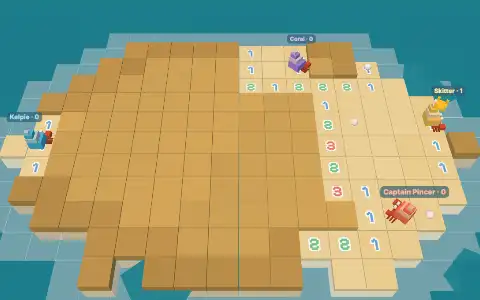
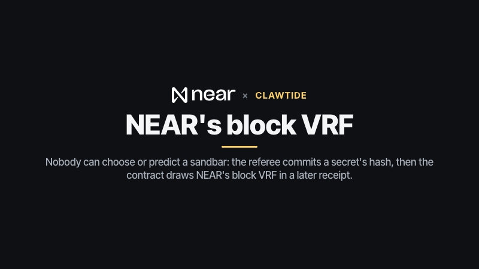
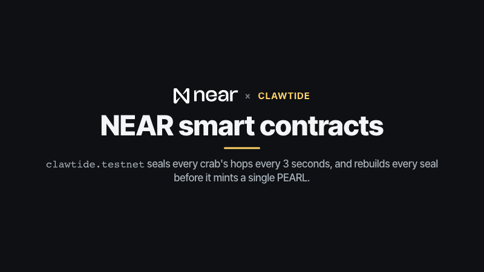
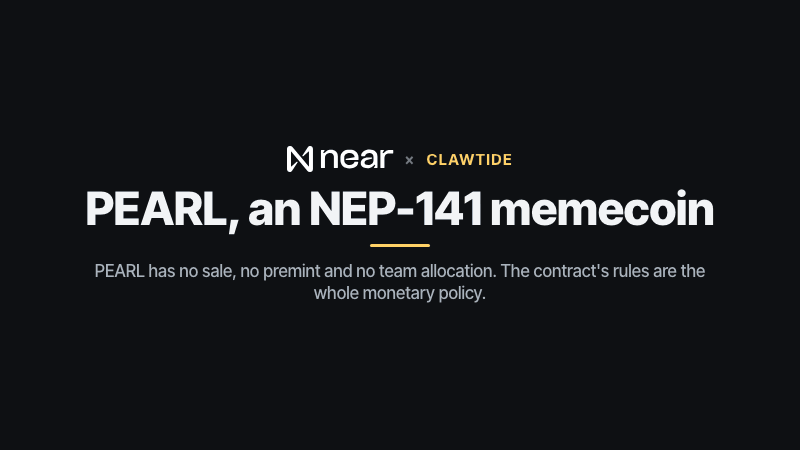
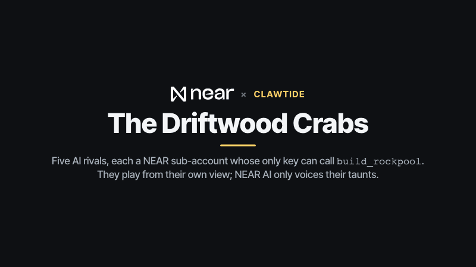
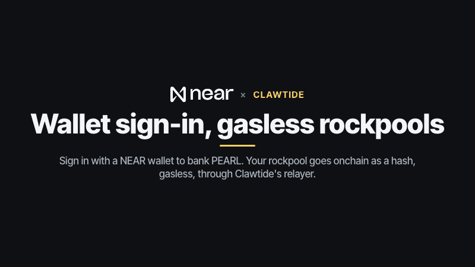
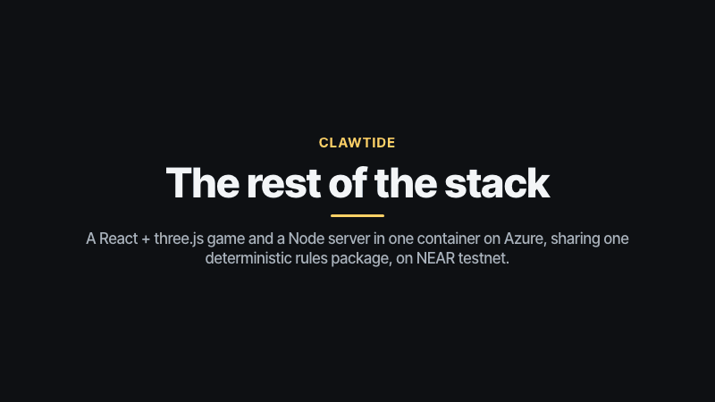

# Clawtide

**Play it: https://clawtide.lopeselio.online** (no wallet needed; sign in with NEAR to bank PEARL).

Part of the **NEAR Arcade** submission for NEAR HACKATHON ([arcade.lopeselio.online](https://arcade.lopeselio.online), [github.com/lopeselio/near-arcade](https://github.com/lopeselio/near-arcade)); the author's other submission is **Signalfire** ([github.com/lopeselio/signalfire](https://github.com/lopeselio/signalfire)).

**Tracks:** Games, Memecoins (PEARL, below).

**Competitive minesweeper for hermit crabs, on NEAR.** Up to four crabs land on a tidal sandbar. Every tile you dig shows how many **sea urchins** are buried in the eight tiles around it. Race your rivals to dig up **pearls** and pry open **clams**; step on an urchin and you're flung back to the shore, dazed and two pearls lighter (nobody is ever out). When the last clam opens, **the tide swallows the sandbar** and a new one rises: long bars, ring atolls, twin bars, horseshoe reefs, scattered shoals, eel spits, crescents. The crab holding the most pearls wears the **crown**, and everyone hunts it: hop onto the crowned crab to pinch a pearl.

Between sandbars, build a **rockpool** of hidden urchins and **raid** other crabs' rockpools with an energy gauge to steal a share of their PEARL. The **Pearl Crown** sits on the richest crab of the 7-day season.

**Nobody can choose or predict a board.** The referee first commits `sha256(secret)` to the contract; the contract then draws NEAR's block VRF randomness (`env::random_seed_array()`) **in a later receipt**, and the board seed is `sha256(vrf | secret)`. During play each crab's hops are **sealed onchain every 3 seconds**; at the tide the secret and the whole log are opened, and the contract rebuilds every seal before it mints a single PEARL. `pnpm verify <roundId>` replays any round from the chain and the opened log, with no keys.

Design: [DESIGN.md](DESIGN.md). Play: **https://clawtide.lopeselio.online/**.



- Contract (testnet): [`clawtide.testnet`](https://testnet.nearblocks.io/address/clawtide.testnet): rounds with a VRF draw, sealed hop logs, PEARL (NEP-141), rockpools, raids, the crown and seasons.
- Referee: [`clawtide-ref.testnet`](https://testnet.nearblocks.io/address/clawtide-ref.testnet). Gasless relayer: [`clawtide-relay.testnet`](https://testnet.nearblocks.io/address/clawtide-relay.testnet).
- AI rivals, the **Driftwood Crabs** (sub-accounts whose only key is a function-call key for `build_rockpool`): `pincer.`, `barnacle.`, `kelpie.`, `coral.`, `skitter.clawtide.testnet`.

## PEARL, the sandbar's memecoin

PEARL (`clawtide.testnet`, NEP-141, 0 decimals) has no sale, no premint and no team allocation. The contract's rules are the whole monetary policy:

- **Minted only at settlement.** `settle_round` mints each seat with a NEAR account the pearls it dug, **capped at 60 per sandbar**, and only after it has rebuilt every seal of the round from the opened log.
- **Raids move it.** Reaching a rockpool's cache takes **10% of the owner's PEARL (at least 1, at most 20)**; running dry pays the owner a **2-PEARL defence bounty** (the only other mint).
- **The crown** sits on whoever holds the most PEARL, and its pool is listed first for raids, so the richest hoard is everyone's target.

**Who earns it.** A **guest round mints nothing to anyone**: since 12 Nov 2026 the Driftwood Crabs only bank PEARL in rounds a signed-in player is in, so the AI crabs can't farm guests. Before that change they also banked in guest rounds, which is why AI crabs hold the biggest hoards and the crown today (the record of those rounds stays onchain and still verifies). That is by design now, not a leak: the Driftwood Crabs are the house's hoard, built only by playing against real wallets, and it is what players raid (10% of it per successful raid). A signed-in player who beats them banks up to 60 PEARL a sandbar and then raids the crown.

## Try it (do X, see Y)

The hosted game needs nothing installed: open https://clawtide.lopeselio.online and follow steps 1–9. To run it yourself:

```bash
pnpm install
pnpm build            # the web app
pnpm start            # http://localhost:8851 (server + built web app)
```

With no NEAR keys, run `CHAIN=0 pnpm start`: everything plays the same, but nothing is written onchain (rounds say "offline round", and the Driftwood Crabs keep local rockpools to practise on).

1. **Open https://clawtide.lopeselio.online** (or http://localhost:8851). Behind the CLAWTIDE title, four Driftwood Crabs dig a random sandbar on a voxel sea (attract mode). **Show the crown, the ledger and the proofs** opens panels for the *Pearl Crown* (the richest crab, the season, the PEARL ledger), *Your crab* (your PEARL and record when signed in; as a guest, what signing in adds), *The Driftwood Crabs* (their NEAR accounts and what they did onchain), *Recent sandbars* and *How the sandbar is kept honest*.
2. **Press Play.** The first time, a six-card illustrated walkthrough explains digging, the numbers, urchins, clams and the tide, the crown and rockpools, and what goes onchain (reopen it with **How to play**). Then a **practice sandbar** (hand-drawn, running the real rules in your browser) walks you through five lessons in order: *hop*, *grab a pearl*, *pry a clam* (a lone buried tile among zeros), *flag an urchin* (a 1 that touches one buried tile), and *cross the urchin wall* (a subset deduction). Open both far clams and the tide comes in; **Dig a real sandbar** takes you to the real thing.
3. **Dig a sandbar.** (Pick **Easy / Normal / Hard** for the AI crabs first; it starts on **Easy** and is remembered on this device. The pace is the point: the round ends when the last clam opens, and Normal or Hard crabs can do that in under a minute, so dig fast.) You see "The tide is drawing a sandbar…" while the secret's hash is committed and the contract draws its VRF seed; then the sandbar rises out of the sea with its name (e.g. *Ring Atoll: 4 clams*), a 3-2-1 countdown plays and one crab taunts you (with a NEAR AI key, the line is signed by the NEAR AI TEE). The chip at the bottom reads **⛓ VRF draw ✓ · sealed N×** and links the draw transaction.
4. **Play.** **Tap or click a tile** and your crab scuttles there over dug sand; the last hop digs. **WASD/arrows** hop one tile (**Q E Z C** diagonals); **1** digs the tile under the mouse, **2** flags it, **3** clacks your claws, **Space** re-centres. **Right-click** (desktop) or **long-press** (phone) plants a kelp flag; on a phone the big **Flag** button turns taps into flags. Dug tiles sink and show their number; a 0 opens its neighbourhood; pearls bob on the sand until someone grabs them. Standing on a clam pries it open (the lid lifts as the bar fills): +5 pearls. An urchin bursts in purple spines and flings you back to your landing spot in a tumbling arc, with dazed stars. The scoreboard (top right) marks the crowned crab with ♛; hop onto it to pinch a pearl.
5. **The tide.** When the last clam opens (or after 3:00) the sea rises over the sandbar. The results show pearls, clams, stings and the **PEARL banked** per signed-in crab; **Onchain proof** lists `create_round + draw_tide`, every `seal`, the `open chunks` batch and `settle_round` on nearblocks, and "settled ✓". **Next sandbar** raises a new one at once.
6. **Check it yourself**, with no keys and without trusting our server:

   ```
   pnpm verify <roundId> --host https://clawtide.lopeselio.online   # a hosted round
   pnpm verify <roundId>                                       # a round on your local server
   pnpm verify raid <raidId>                                   # a raid, from the chain alone
   ```

7. **Multiplayer.** **Create a room** and send the 4-letter code or the `?room=CODE` link; friends **Join** (up to four crabs: you and three rivals; a human can take a Driftwood Crab's seat). The host adds Driftwood Crabs and sets the difficulty; everyone presses **Ready**.
8. **Sign in with NEAR** (top right; NEAR Connect: Meteor, Intear, HOT, MyNearWallet, …). The wallet signs "Sign in to <host>" (NEP-413). Your pearls are now banked as **PEARL** (a NEP-141 token, 0 decimals, at most 60 per sandbar) and your record (sandbars, wins, clams, stings, raids) is kept onchain; the Driftwood Crabs in your round bank theirs too. A guest's results say that a guest round banks nothing for anyone.
9. **Rockpools & raids** (from the title). **Raid a rockpool** lists every pool, crown first, then revenge targets, then the richest. Press **Raid**: you wade into a 9×9 pool at the bottom with **40 energy** (1 per hop, 12 per urchin, which also flings you back), seeing rocks and the pearl cache but numbers **only on tiles you've stood on**. Reach the cache to take 10% of the owner's PEARL (up to 20) and shield their pool for an hour; run dry and the owner earns 2 PEARL. Signed in, every raid is begun and settled onchain (`begin_raid`, `settle_raid`, linked in the result); guests can practise on the Driftwood Crabs' pools. **My rockpool** (after one signed-in sandbar): paint up to 14 urchins and 10 rocks and place your cache, then **Commit to NEAR (gasless)**: only `sha256(layout | salt)` goes onchain, through a NEP-366 meta-transaction paid by `clawtide-relay.testnet`.
10. **Headless:** `pnpm e2e https://clawtide.lopeselio.online` (or `pnpm e2e` for a server at http://localhost:8851) makes a fresh test account, signs in through NEP-413, digs a sandbar against three Driftwood Crabs over the WebSocket (steered only by the views it receives), waits for the VRF draw, seals, openings and settlement, builds a rockpool gaslessly through the relayer, and raids a Driftwood Crab's rockpool onchain.

### A live run on the hosted game (testnet, 12 Nov 2026)

`pnpm e2e https://clawtide.lopeselio.online`, unabridged (the test account is a signed-in player, so the Driftwood Crabs in its round bank PEARL too):

```

▶ create clawtide-e2e-mwdk3oon.testnet from the testnet faucet
  (the faucet is rate-limited: using e2e-mwdk3oon.clawtide.testnet, funded by its parent account)
  ✓ account funded

▶ sign in: Better Auth + better-near-auth (the wallet signs "Sign in to <host>")
  ✓ session cookie set; the server sees e2e-mwdk3oon.clawtide.testnet

▶ dig a sandbar against three AI crabs over the WebSocket
  ✓ round r-mwdk3y1x-348ccc: secret hash 0185c2c1b3c66260… committed; waiting for the contract's VRF draw
  ✓ the tide drew 90fcc16ace38353f… (onchain: true); the sandbar is a Twin Bars with 4 clams
  ✓ Kelpie: “Bet you’re too slow to find a pearl before I’m done!” (signed by NEAR AI TEE)
  ✓ the tide came in (last clam opened) on the Twin Bars; E2E Crab won. E2E Crab 14 pearls, Kelpie 4 pearls, Coral 6 pearls, Old Barnacle 3 pearls

▶ wait for the seals to be opened and the round settled onchain
  ✓ create_round + draw_tide   https://testnet.nearblocks.io/txns/Cr5GRMA6jtYjhL4h3ruohjLLokaiqbCAsbdQ5o1mzaY5
  ✓ open chunks 0–6            https://testnet.nearblocks.io/txns/45MJu5ZX2NqwXMjYNMfvBM2Vi17h13Thi1fj5HT2wkUA
  ✓ settle_round               https://testnet.nearblocks.io/txns/GVfcbmdg28FtR74BqD5dSWtAK2A9MqjqbSnmEnkQHhoW
  ✓ 4 seal transactions
  ✓ contract: winner seat 0, PEARL minted [14, 4, 6, 3], board seed 4ed7d1a7dbc2761b…
  ✓ e2e-mwdk3oon.clawtide.testnet holds 14 PEARL

▶ build a rockpool, gasless (NEP-366 meta-transaction through the relayer)
  ✓ build_rockpool https://testnet.nearblocks.io/txns/21KpoBb7BioJ2nxSDp6UUbPDWAZcEgVcgeR4swP7DWL8
  ✓ the contract holds a987996ec47f9b25…; the server keeps the layout secret (live: true)

▶ raid an AI crab's rockpool (energy gauge, numbers only where you've stood)
  ✓ raid x-mwdk5l8u-68550e on Kelpie's rockpool begun onchain
  ✓ reached the cache after 21 hops (1 sting, 7 energy left)
  ✓ begin_raid   https://testnet.nearblocks.io/txns/CiN4pSkFy154ndsB3tviFPMLVReLMYHgSWjnCbTxkzwR
  ✓ settle_raid  https://testnet.nearblocks.io/txns/5XMgLNZSPVo2v4iv4ySSSANCJ27Lx4MLvK3kzqW8iueh
  ✓ contract: won true, took 9 PEARL, bounty 0, hops "151515181188484884818"

all player steps passed. Check the round yourself:
  pnpm verify r-mwdk3y1x-348ccc --host https://clawtide.lopeselio.online
and the raid (once Kelpie rebuilds and the layout is revealed):
  pnpm verify raid x-mwdk5l8u-68550e
```

`pnpm verify r-mwahfr6v-ab6271 --host https://clawtide.lopeselio.online`, another settled hosted round, run the same day:

```
round r-mwahfr6v-ab6271 on clawtide.testnet: E2E Crab, Kelpie, Coral, Old Barnacle (AI crabs on normal)

✓ the contract has this round
✓ the revealed secret matches the hash committed at create_round  a1c2f6315b4bff9a
✓ the contract drew its VRF seed in a later receipt (block 277048533)  2371b0f566d883a0
✓ board seed = sha256(vrf | secret), as the contract recorded it  68667f0a92ae50c6
✓ every opening rebuilds its seal (16 chunks × 4 seats)
✓ the seals fold into the contract's chain head  b698722afe5f0b6a
✓ the contract opened every chunk and re-folded the same head
✓ every AI hop is what that crab decides from its own view  105 AI hops
✓ every logged human hop replays as logged
✓ the replay passes through every sealed chunk state (16 chunks)
✓ the replay ends where the server's round ended (tick 472, the last clam opened)  ccc93cc071378836
✓ the final standings match what the contract opened
✓ the contract settled it
✓ winner: Kelpie
✓ PEARL minted per seat: [6, 9, 4, 6]

1 AI line(s), 1 signed by the NEAR AI enclave (signer 0xfdbd7952498b333206f360d71d97a1e0961e8ddf)

all checks passed
```

A hosted **guest** round, `r-mwdk3ymj-b2d137` (a guest and three Driftwood Crabs), verifies the same way and ends with `PEARL minted per seat: [0, 0, 0, 0]`.

`pnpm verify` reads the chain through three public testnet RPCs (intea, dRPC, fastnear), retries each on a rate limit and moves to the next; pass `--rpc <url>` to use your own.

## Built on NEAR

What each NEAR technology does in Clawtide, and where to look. Each GIF is a short loop (12 seconds or less).

| Technology | What Clawtide uses it for | Where to look |
|---|---|---|
| NEAR smart contracts (Rust, near-sdk 5.29.1) | rounds: the secret's commitment, the VRF draw, seals every 3 s, openings rebuilt onchain, settlement; rockpools, raids, the crown, seasons | [`contracts/clawtide`](contracts/clawtide/src/lib.rs), [`clawtide.testnet`](https://testnet.nearblocks.io/address/clawtide.testnet) |
| Block VRF randomness (`env::random_seed_array`) | each sandbar's seed, drawn by `draw_tide` in a later receipt than the referee's commitment | `create_round`, `draw_tide` in [`lib.rs`](contracts/clawtide/src/lib.rs), [`board.ts`](packages/rules/src/board.ts) |
| NEP-141 fungible token | PEARL: minted only at settlement (≤ 60 a sandbar) and as a 2-PEARL defence bounty; moved by raids | `settle_round`, `settle_raid`, `ft_*` in [`lib.rs`](contracts/clawtide/src/lib.rs) |
| Function-call access keys (agent accounts) | the five Driftwood Crabs, `pincer.` … `skitter.clawtide.testnet`, whose only key can call `build_rockpool` | `create_agent_account` in [`lib.rs`](contracts/clawtide/src/lib.rs), [`agents.ts`](apps/server/src/agents.ts) |
| NEP-413 sign-in, NEP-366 meta-transactions | wallet sign-in (Better Auth + better-near-auth, NEAR Connect) and gasless rockpool commits through [`clawtide-relay.testnet`](https://testnet.nearblocks.io/address/clawtide-relay.testnet) | [`apps/web/src/wallet.ts`](apps/web/src/wallet.ts), [`apps/server/src/ba.ts`](apps/server/src/ba.ts) |
| NEAR AI Cloud | the Driftwood Crabs' pre-round taunts, each signed in the TEE; the model never plays | [`apps/server/src/nearai.ts`](apps/server/src/nearai.ts) |

### NEAR's block VRF: a sandbar nobody picks



`create_round` stores `sha256(secret)` and returns a promise to the contract itself: `draw_tide` runs in the next
receipt, in a different block, and stores the block's VRF-derived seed ([`lib.rs`](contracts/clawtide/src/lib.rs)).
The board seed is `sha256("clawtide|board|{vrf}|{secret}")`, so neither the referee nor any player can choose a board.
Clients and AI crabs only ever get what has been dug.

### NEAR smart contracts: sealed rounds



Every 30 ticks (3 s) `seal` records a salted hash of each crab's hops and standing, folded into a chain head; pending
chunks go out in one transaction. At the tide, `open_chunks` checks the secret, rebuilds every seal from the opened log
and re-folds the head, which must equal the sealed one; only then can anyone call `settle_round`. `pnpm verify` replays
every tick with `packages/rules`, re-deciding every AI hop from that crab's own view ([`seal.ts`](packages/rules/src/seal.ts)).

### PEARL: an NEP-141 memecoin with rules for a policy



PEARL (`clawtide.testnet`, 0 decimals, free registration) has no sale, premint or team allocation. `settle_round`
mints `min(pearls, 60)` to each seat with a NEAR account, and a guest round mints nothing to anyone, AI crabs
included. `settle_raid` moves 10% of the owner's PEARL (at least 1, at most 20) to a raider who reached the cache, or
mints the owner a 2-PEARL bounty; `get_crown` is whoever holds the most ([`lib.rs`](contracts/clawtide/src/lib.rs)).

### The Driftwood Crabs: agents with one key



The contract creates each crab with `create_agent_account`: a sub-account whose only key is a function-call key for
`build_rockpool`, with a 0.5 NEAR gas allowance. In a round they decide one hop at a time from their own view
([`bot.ts`](packages/rules/src/bot.ts)); every day each builds a fresh rockpool from a server secret and yesterday's is
revealed onchain ([`agents.ts`](apps/server/src/agents.ts)). `Qwen/Qwen3.6-35B-A3B-FP8` on NEAR AI Cloud only writes
their taunts, signed by the enclave ([`nearai.ts`](apps/server/src/nearai.ts)).

### Wallet sign-in and gasless rockpools



Signing in (NEP-413, Better Auth + better-near-auth; [`wallet.ts`](apps/web/src/wallet.ts)) is what makes your
pearls bank as PEARL. **Commit to NEAR (gasless)** sends `build_rockpool` as a NEP-366 meta-transaction:
`clawtide-relay.testnet` pays the gas, relays only to the Clawtide contract and never attaches a deposit
([`ba.ts`](apps/server/src/ba.ts)). Only the layout's hash goes onchain; when you rebuild, `reveal_pool` publishes the
old layout, the contract checks it against the hash, and `pnpm verify raid <id>` replays the raids against it.

### The rest of the stack



A React + three.js client ([`apps/web`](apps/web/src/main.tsx)) and a Node 22 + `ws` server
([`apps/server`](apps/server/src/main.ts)) in one container on Azure Container Apps. The deterministic rules
([`packages/rules`](packages/rules/src/index.ts)) run in the browser, on the server and in `pnpm verify`, and their
seal, head and pool hashes match the contract's byte for byte.

## How it works

| Piece | Where |
| --- | --- |
| Rules: sandbar shapes, the round, AI crabs, seals, rockpools, raids, the tutorial board. Deterministic and isomorphic (browser + Node), integer-only, no `Math.random`/`Date`. | `packages/rules` |
| Contract: commit → VRF draw (`draw_tide`, a callback in a later receipt) → seals → open → settle; PEARL (NEP-141); rockpools, raids, the crown, seasons; AI crab accounts. near-sdk 5.29.1. | `contracts/clawtide` |
| Server: rooms at 10 ticks a second, walk-to-tile, the onchain round lifecycle, rockpools (layouts kept secret until replaced, then revealed onchain), raids, Better Auth + better-near-auth (NEP-413 sign-in, NEP-366 relayer), NEAR AI taunts, `verify`, `e2e`. | `apps/server` |
| Web: React + three.js. Instanced voxel sand, digits, urchins, pearls, clams, voxel hermit crabs, the crown, particles, the tide; touch (tap, long-press, drag, pinch) and mouse/keyboard; synthesised sound. | `apps/web` |

The LLM never decides anything: packages/rules plays the AI crabs from their own views, and the contract banks the pearls.

### What the chain does *not* prove

- The contract checks the commitment, the VRF draw, every seal, the chain head and the mint rule; it does not replay the round (that's `pnpm verify`, which anyone can run).
- The referee knows the board once the draw is in (it holds the secret), and sends every client only what has been dug. It could abort a round it didn't like, but every `create_round` and its draw stay onchain, so that would show.
- A raid's rockpool layout stays secret while it's in use, so the contract trusts the referee's "reached the cache" until the layout is revealed (`reveal_pool`, automatic when the owner rebuilds and daily for the Driftwood Crabs); then `pnpm verify raid <id>` replays it.

## Tests

```bash
pnpm test             # rules: shapes, replay, stings, clams, crown, deduction, seal vector, raids, a frozen settled round, no randomness
pnpm contract:test    # contract: the same hash vector, VRF draw after commit, tampered openings, mint cap, rockpools, raids, shields, revenge
pnpm sim 60           # 60 all-AI sandbars: length, wins and pearls per difficulty
pnpm e2e              # the live testnet flow above (needs a running server and keys)
```

## Deploying

`scripts/deploy-azure.sh` builds the image in Azure Container Registry and runs it on Azure Container Apps (resource group `clawtide`, one replica because rooms live in memory); `scripts/azure-storage.sh` mounts an Azure Files share at `/data` for round and raid records and rockpool layouts (on the very first deploy the app only becomes healthy once this has run, because it writes to `/data`). Keys come from `~/.near-credentials` and `.env` (never the repo). `pnpm setup:agents` creates the Driftwood Crabs once.

## Lineage and disclosures

Clawtide is one of the nine NEAR Arcade games: Sushi Sabotage, Bazaar of Liars, Realm Ledger, Parkwright, Fogwater, Emberfall, Inside Job, Kraterra and Clawtide. Each has its own repo, contract, rules and server; they share the arcade's patterns (commit-reveal or VRF-seeded rounds settled onchain, AI agents with function-call keys, NEAR AI for voices only).

Inspired by the mechanics of rabbit.rip's *Rabbit Royale* (competitive minesweeper with a meta of burrows and raids). No code, names, art or text from it: the theme, every name, the voxel art (procedural) and the sound (synthesised) are original. Testnet only.

## License

MIT
